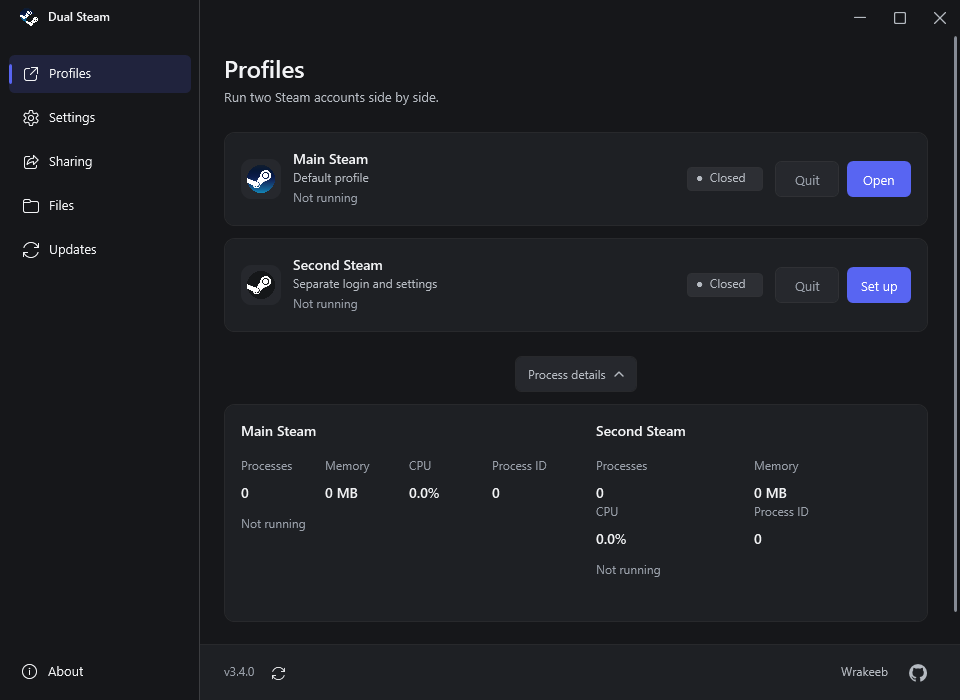
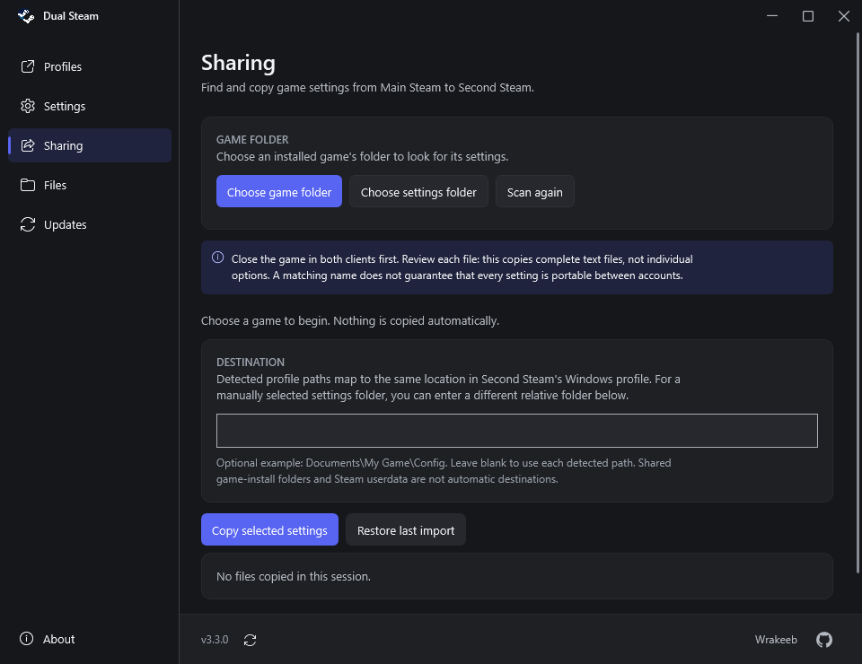
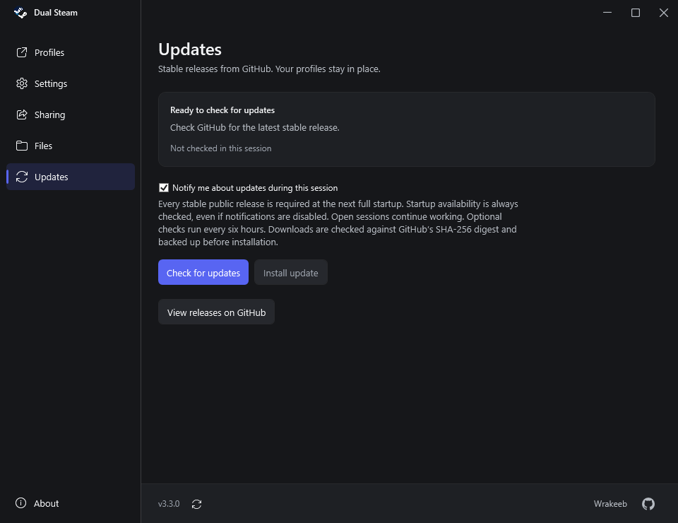
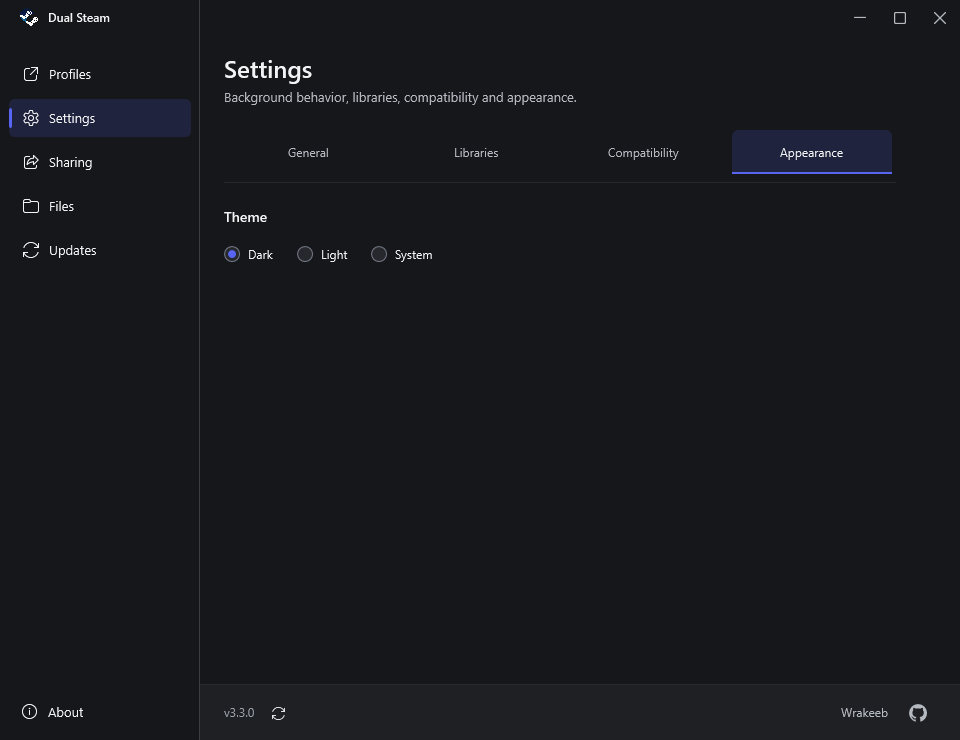
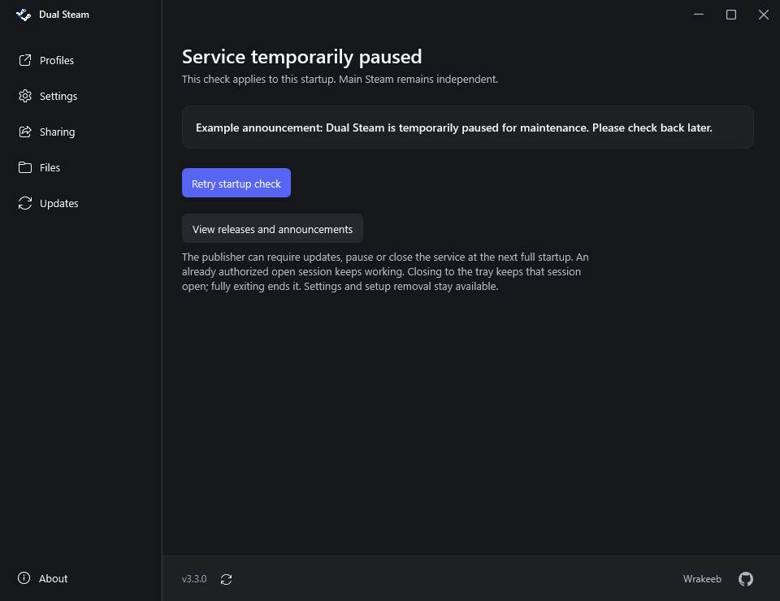
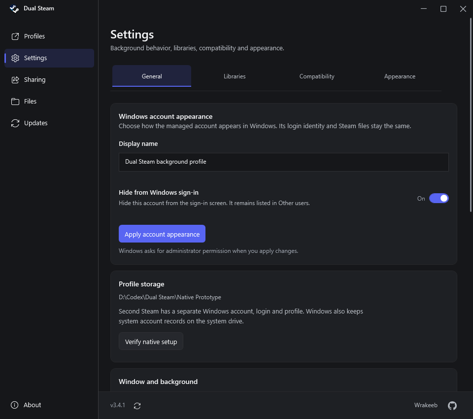
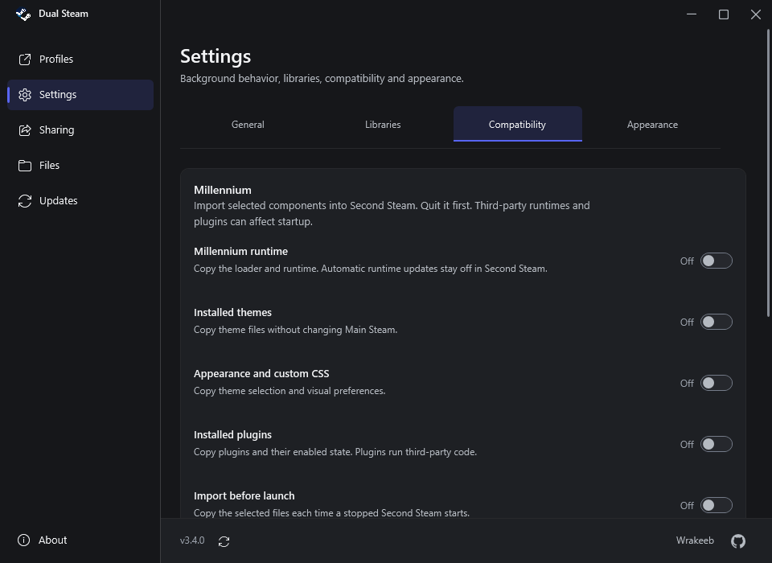
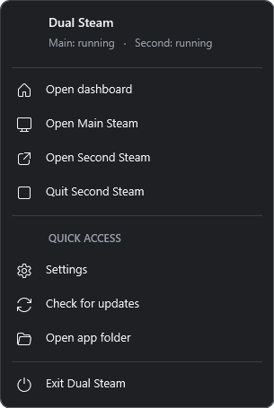

# Dual Steam

Two independent Steam logins on one Windows desktop, with separate account data and shared installed game libraries.

**Windows 10 / Windows 11, x64 · .NET Framework 4.8 · Version 3.4.1**

[Download the latest release](https://github.com/w-rakeeb/dual-steam/releases/latest)

## First-time setup

1. Download **Dual-Steam-Windows.zip** and extract the entire ZIP into a writable folder. Keep all of its files together.
2. Open **Dual Steam.exe**. Choose **Set up** on the second profile.
3. Confirm the detected main `steam.exe`, or browse to it. Choose a separate, empty local folder for the second client and its Windows profile.
4. Approve the Windows administrator prompt. Setup creates a uniquely named **standard** local Windows account, not an administrator account. Your existing Steam installation and login remain in place.
5. Open Second Steam. Steam downloads/updates its clean client, then asks you to sign in to the second Steam account. Enter passwords and Steam Guard codes only inside Steam.
6. Use **Settings → General → Add / repair desktop shortcuts** if you want a direct Second Steam shortcut.

You stay on your current Windows desktop. No Sandboxie, virtual machine or manual Windows account switching is used. Administrator permission is needed for account/profile setup, not routine Steam launches. Windows retains system account records and a small initial profile backup on its system drive; this is not a guarantee of zero system-drive usage.

## What it does

| Area | Features |
| --- | --- |
| Profiles | Open, focus and quit Second Steam; recover hidden Library windows; identify an interface still starting |
| Performance | Client process count, summed working-set memory, sampled CPU, root PID and uptime; games are separate |
| Appearance | Dark, Light and System themes; equal-sized Steam artwork; distinct second-client taskbar identity and icon |
| Background | Close manager to tray; optional second-client tray control; authorized manager session required |
| Libraries | Detect existing libraries on any drive, including the system drive when selected; no copying entire games |
| Sharing | Dynamic game-folder discovery, manual settings-folder selection, per-file review/copy/restore; detected Millennium imports |
| Maintenance | Repair shortcuts, reset manager preferences, scan text settings, save diagnostics and restore the last settings import |
| Updates | Signed startup availability and mandatory stable releases; optional session notifications; verified installation and rollback |

The Second Steam shortcut starts/focuses the client with the dashboard hidden. Reopening the manager shortcut restores the same dashboard instead of starting another copy.

## How isolation and storage work

Second Steam runs as the managed standard local account, with its own Windows profile, user registry, Steam configuration, cache and game saves. Separate Steam IPC identifiers prevent normal launch requests from being routed to the other client. A local authenticated named pipe connects the manager to the background controller; account credentials are encrypted for the Windows user who performed setup and are not uploaded anywhere.

| Content | Location |
| --- | --- |
| Manager preferences, encrypted setup state and logs | `<app folder>/Data` |
| Second Steam binaries, config and userdata | `<chosen data folder>/Client` |
| Second Windows AppData, settings and saves | `<chosen data folder>/Windows Profile` |
| Supported game-settings backups | `<chosen data folder>/Evidence/Settings Imports` |
| Add-on and application-update backups | `<app folder>/Backups` |
| Update downloads | `<app folder>/Updates` |

The existing development installation retains its legacy folder name without relocating its working Windows profile. Fresh installations use the folder chosen in setup. Do not copy a configured installation to another PC: download the clean release and run setup there. Do not share `Data`, Windows profiles, Steam userdata or credentials.

Game libraries are the real shared files. A Steam/game update changes those shared files. Local game preferences, Steam Cloud data and publisher-account preferences are different things and can be stored separately. Sharing a game installation does not automatically share every setting.

## Sharing and add-ons

**Game settings:** choose an installed game folder. The scanner reads its Steam manifest and project-folder names, then looks for matching folders in Main Windows AppData, Documents and Saved Games. You can select a settings folder manually when names differ. Review candidate files, select individual files, and copy them into corresponding locations in the second Windows profile. A custom relative destination is available for manual folders. Nothing is selected or copied automatically. Text INI/CFG/JSON/XML/YAML/TOML/properties/TXT/VDF settings are supported; binary saves, account/progress data, system/launcher destinations, linked paths and secret-bearing files are excluded. This is a heuristic, not a universal settings converter: files may contain account-specific paths or options, and Steam userdata/cloud/registry/binary settings are not automatically imported. Existing targets are backed up; restore refuses files changed since import. Close the selected game in both clients first. Scans and copies are bounded; source changes invalidate the scan.

**Millennium:** import options appear only when the main client contains the relevant components. Choose the runtime, themes, appearance configuration/custom CSS, and plugins separately. Proxy credentials, Steam logins and unrelated root DLLs are excluded. Importing add-ons is optional and off by default; plugins/themes can run code in Steam and can affect stability. Quit Second Steam before importing. Main Steam can stay open. Backups are retained.

THE FINALS and Among Us local folders can be detected for inspection, but their binary/account files are not blindly synchronized. Additional games need format-specific adapters.

## Background mode and tray menus

The public build requires an authorized manager session. An explicit manager exit closes Second Steam; if the manager disappears unexpectedly, the controller closes the second client and its verified tracked games after a short grace period. Save your game before exiting. Main Steam remains independent.

Dual Steam's own tray controls follow its selected theme. Steam's original native tray icon/menu can remain alongside them; Explorer internals are not patched or injected.

## Updates and release safety

Updates come only from this repository's stable GitHub releases. The updater validates the release digest, rejects unexpected/path-traversal/private-data ZIP entries, creates backups and rolls back on failure. Quit Second Steam before installing; Main Steam can remain running. The release never includes configured accounts, logins, game saves, personal settings or Millennium binaries.

If first-time setup is interrupted, its protected journal and encrypted credential are retained so an owned partial setup can resume without replacing another Windows account. A matching account/profile is never silently taken over. Diagnostic files remain local unless you choose to share them.

## Compatibility and validation

This is an independent utility, not an official Valve multi-client feature. Steam updates, third-party overlays, anti-cheat systems and individual games can affect compatibility. Do not assume that every game or simultaneous-game combination works.

The existing PC has run both Steam logins, ARC Raiders, Among Us and Medal clipping in the recorded tests. The current build includes core validation, update rollback/package tests and live lifecycle tests. Windows 10/11 x64 are targeted using .NET Framework 4.8 and supported desktop APIs; Windows 10 and every fresh-PC/game combination have not been independently runtime-tested. Generic settings portability still needs per-game confirmation; cloud or publisher settings can override local files.

This build is not code-signed. Windows may show its usual downloaded-app or administrator prompts. No passwords or Steam Guard codes should be entered into Dual Steam.

## Build

On Windows x64 with .NET Framework 4.8:

```powershell
.\Source\Build.ps1
.\Tests\Run.ps1
.\Source\Package.ps1
```

The build produces the manager, updater and native controller. The package script uses an explicit runtime-file allowlist and excludes private data. Source code is MIT licensed. Steam names, logos and other trademarks belong to Valve; the artwork source is documented in `Assets/SOURCE.md`.

Medal integration is left unchanged during launch. The optional compatibility control is troubleshooting only, not a requirement or a confirmed diagnosis. Main Steam, Second Steam and the manager have distinct taskbar identities; desktop and recognized pinned shortcuts are repaired by Add / repair desktop shortcuts.

## Version 3.4.1 Windows account appearance

Under **Settings → General → Windows account appearance**, enter a display name, choose **Hide from Windows sign-in**, and click **Apply account appearance**. Applying requests Windows administrator permission. The display name changes the Windows full-name field; the internal login name, SID, profile paths and Steam credentials remain unchanged ([Windows API](https://learn.microsoft.com/en-us/windows/win32/api/lmaccess/nf-lmaccess-netusersetinfo)).

New setups are hidden from the Windows sign-in account list by default. Existing setups apply this default once at their next authorized startup; if administrator approval is declined, use the Apply button to retry. An explicit show-account choice is preserved. The account remains visible under Windows Settings → Accounts → Other users. Sign-in hiding is a display preference, not an account-disable or security boundary ([Microsoft Q&A](https://learn.microsoft.com/en-ie/answers/questions/1281830/how-to-remove-user-account-from-windows-logon-scre)).

Only the verified managed standard account can be changed. The setup owner's account and unrelated accounts are rejected. A failed save rolls back the name and sign-in value. Setup removal clears only this managed account's visibility entry. Existing preference reset does not reset Windows account appearance.

**Validation:** 123 automated checks, native display-name round trip, hide/show round trip, unchanged account SID, preserved explicit visibility choice, and dark/light Settings renders. The actual Windows sign-in screen was not exercised by signing out or rebooting; recipient-PC and Windows 10 behavior still need confirmation.

## Version 3.4.0 stability and desktop controls

- **Independent startup:** the second Windows account's Steam registry path is initialized to its own client before launching. Millennium reads that per-user registry path on Windows ([upstream v3.6.2 source](https://github.com/SteamClientHomebrew/Millennium/blob/v3.6.2/src/system/filesystem.cc)). A generic Steam URL is no longer passed during second-client startup. Use the manager/tray profile controls for the correct IPC route, especially when opening Main Steam after Second Steam.
- **Scoped shutdown:** client stops are rechecked against the managed Windows SID and client folder. Steam launcher/helper processes are excluded from game-log shutdown targets. The root client stops before helpers, lingering owned helpers are drained, and reconnect waits for an exiting controller rather than using a stale pipe.
- **Millennium recovery:** imports disable automatic Millennium/plugin/theme update preferences in the second copy. Disabling the imported loader also disables automatic re-import. If an owned imported loader exits during the first startup checks, it is backed up and disabled and one clean launch is attempted. Changed/unrecognized loaders are preserved. Import failures roll back files and their recovery record; temporary files are removed. Use Launch without Millennium or Disable imported Millennium runtime if needed. Arbitrary third-party plugins and all Millennium versions are not guaranteed compatible.
- **Full Exit:** the tray and General settings expose Exit Dual Steam. It ends the authorized session, stops Second Steam and tracked games, removes idle controllers, and exits the manager process. Main Steam stays independent. An Exit request during a download cancels it; other critical operations finish before exit. Ending the manager through Task Manager causes the second controller to clean up after its grace period. Save games before exiting.
- **Updates:** startup checks race two independently verified signed GitHub routes. No unsigned/offline service bypass was added. Downloads have longer connection/read timeouts, three attempts, progress, cancellation, checksum verification and persistent error feedback. A browser ZIP fallback is available. Existing older updaters may need one manual in-place replacement.
- **Interface:** a rounded, themed tray menu groups profile controls, Settings, Check for updates, Open app folder and full Exit. Settings use cards and switch rows; maintenance actions are grouped. Text spacing, narrow-layout metrics and uptime labels are clearer. Missing Steam paths no longer crash optional add-on/performance detection.

**Validation:** 111 automated checks and live Windows 11 checks for both launch orders, imported Millennium startup, quitting Second while preserving Main, normal/background/idle-controller full Exit, forced-manager cleanup, actual GitHub download/cancellation, and a disposable same-account Steam process protected from a misleading game-log PID. A deliberately failing owned loader recovered to one clean client. The temporary account was removed. Games were not re-tested in this release; Windows 10, the recipient PC and arbitrary plugin/game combinations still need confirmation.

## Version 3.3.3 complete reset recovery

An interrupted legacy removal can delete the selected profile but leave its Windows account. A later launch makes Windows recreate that same SID's profile under its default Users directory, sometimes with a computer-name suffix. Previous versions incorrectly rejected that registered path as an unexpected location.

Removal now previews the Windows-registered path, validates its managed account name/SID, owner, protected recovery record, default profile directory, and exclusions, then removes the registered profile and original selected folder. The verified path stays in the protected recovery marker if cleanup is interrupted again. Main Steam, owner/system profiles, shared libraries, junction targets and other accounts remain protected. Remove is also available when account metadata survives but settings.json is missing.

Install into the existing app folder without deleting Data or Profiles. Quit Second Steam and games. In Settings → General, choose Finish removing setup (or Remove Dual Steam setup), review paths, back up remaining saves, and approve removal. After success, create Second Steam again. In-app updates have a direct ZIP download fallback; older broken updater builds may need one manual replacement.

Validation: 92 automated checks. A disposable account reproduced the exact older-version unexpected-location error after Windows recreated its profile in Users. Patched removal succeeded, a new setup succeeded in the same folder, and removal succeeded with missing preferences and a live managed controller. Main Steam's original process was unchanged. The recipient PC still needs confirmation.

## Remove a configured setup

In Settings → General, choose **Remove Dual Steam setup**. The preview lists the managed account and second-client folder, requires backup acknowledgment, and requests Windows administrator approval. Quit Second Steam and its games first. Removal verifies the Windows SID/profile, refuses shared-library/Main Steam overlaps, waits for profile release, removes only the configured account/client/profile/bootstrap backup, restores an enabled Medal compatibility block, and clears setup data and Second Steam shortcuts. Child junctions are unlinked without traversing their targets. Interrupted removal retains recovery records; Windows locks or an unverified profile stop removal rather than forcing it.

This removes the configured second setup. The portable manager, source and historical app backups stay available; delete the extracted manager folder separately to remove those. Export any local saves/settings before confirming. Other manually created profiles or unrecorded legacy folders are not discovered by name and deleted.

Update checks now have a visible progress state, disabled repeat action, persistent result, installed/public versions and a last-checked timestamp. Failed checks clear stale install actions. New settings-import backups are checksummed before restore; older receipts remain readable. Diagnostic reports use the actual installed version.
## Screenshots

Captured from the Windows app at 960 px; closed profiles represent an idle interface.

| Profiles and performance | Game-settings discovery |
| --- | --- |
|  |  |

| Updates | Appearance |
| --- | --- |
|  |  |

Example startup announcement (illustration of the real app screen, **not** the current live service status):




### Settings and tray controls

| General settings | Millennium and compatibility |
| --- | --- |
|  |  |

Tray-menu appearance preview (running labels shown as an example):


## Startup availability and required updates

Official builds from v3.3.0 verify a signed GitHub announcement on each full manager startup. All stable public releases are required at the next startup: an outdated build cannot authorize Second Steam until updated. A paused or closed service shows the publisher's announcement. An already authorized open session continues working; closing to the tray keeps it open, while full exit ends the session. Internet is required for a new startup. Settings/removal remain available, and Main Steam stays independent.

The public build requires its manager session. Separate desktop shortcuts still work by opening the manager silently before Second Steam. There is no telemetry or statistics service. Older/modified builds cannot be retroactively revoked. See [publisher controls](Publisher/README.md) for Active / Paused / Closed controls and announcements. Closing the publisher's local app does not disable other PCs; the GitHub control workflow changes the policy.